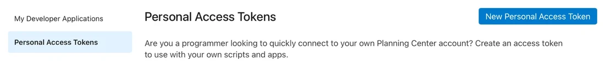
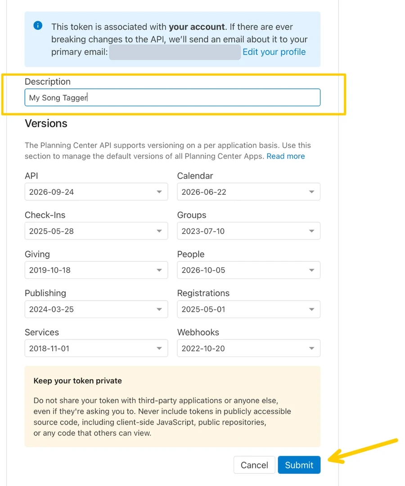
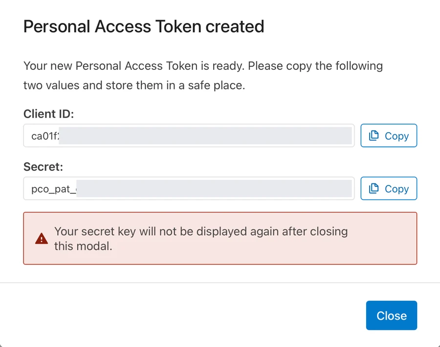
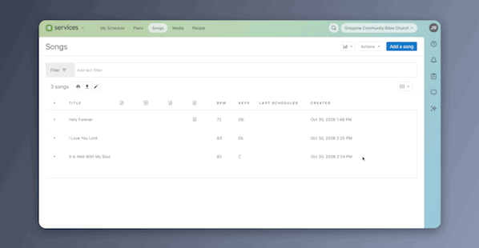

# Admin Guide: Tagging Your Songs in Planning Center

This guide walks you through every step with the **HV Song Tagger** app. You
don't need any technical background. If you can download an app and copy and
paste, you can do this.

**How long it takes**

- One-time setup: about 15 minutes
- Tagging: about 1 to 2 hours for 150–200 songs. You can split it across
  several sittings.
- Sending the directional ratings to Planning Center: about 5 minutes

**What you need**

- A Mac or a Windows 10 or 11 PC
- A Planning Center login that can **edit songs** in Services. If you're not
  sure you have this, ask whoever manages Planning Center at your church.
- Claude, ChatGPT, or Gemini, only if you want AI to suggest ratings

---

## Part 1: One-time setup

### Step 1: Download and open the app

1. Download the file for your computer:
   - **Mac:** [HV-Song-Tagger-Mac.dmg](https://github.com/EquipEngine/planning-center-song-tagger/releases/latest/download/HV-Song-Tagger-Mac.dmg)
   - **Windows:** [HV-Song-Tagger-Windows-Setup.exe](https://github.com/EquipEngine/planning-center-song-tagger/releases/latest/download/HV-Song-Tagger-Windows-Setup.exe)
2. Open it. The first time, your computer warns you, because the app isn't
   registered with Apple or Microsoft (that costs a yearly fee). You only have
   to do this once.

**On a Mac:**

1. Open the downloaded file and drag **HV Song Tagger** into your
   **Applications** folder.
2. Double-click **HV Song Tagger** in Applications. A box says Apple *could
   not verify* it. Click **Done**, not Move to Trash.
3. Open the Apple menu, choose **System Settings**, then **Privacy & Security**.
4. Scroll down to **Security**. Next to the message about HV Song Tagger, click
   **Open Anyway**.
5. In the box that appears, click **Open Anyway** again, then enter your Mac
   password or use Touch ID.

If you don't see **Open Anyway**, double-click the app again, then go back to
Privacy & Security. On macOS 14 or older, you can instead Control-click the
app, choose **Open**, and click **Open**.

**On Windows:**

1. Double-click the downloaded **HV-Song-Tagger-Windows-Setup** file.
2. If a blue *Windows protected your PC* box appears, click **More info**, then
   **Run anyway**.
3. Follow the installer, then open **HV Song Tagger** from the Start menu.

> **Tip:** On the first screen, choose **Practice with sample songs**. It runs
> the whole process with made-up songs and a pretend Planning Center, and
> nothing real changes. It's the best way to see what's ahead.

### Step 2: Connect the app to Planning Center

The app needs a key, called a **Personal Access Token**, so it can read your
songs and update their tags. The key is two codes: a **Client ID** and a
**Secret**.

1. In the app, click the **Planning Center developer page** link, or open
   `https://api.planningcenteronline.com/personal_access_tokens` in your
   browser, and sign in.
2. Click **New Personal Access Token**.

   

3. Type a **Description**, such as "Song Tagger." Leave the Versions as they
   are, then click **Submit**.

   

4. Click **Copy** next to the **Client ID** and paste it into the app. Do the
   same with the **Secret**. The Secret is shown only once, so don't click
   **Close** until you've connected.

   

5. Leave **Remember this key on this computer** ticked if you'd like the app to
   reconnect by itself next time. Untick it if others use this computer.
6. Click **Connect**.

> **About the key:** treat it like a password. The key can do anything *you*
> can do in Planning Center, not just edit songs. Depending on your access,
> that can include People records (members' addresses and phone numbers) and
> Giving.
>
> The app sends it only to Planning Center. If you ask it to remember the key,
> it's kept in your Mac's Keychain or Windows Credential Manager, which are
> locked with your computer password.
>
> When you're done tagging for good, delete the key on the same Planning
> Center page where you created it, and click **Forget saved key** at the top
> of the app. You can make a new key in a minute the next time you have songs
> to tag.

### Step 3: Create the directional rating tags in Planning Center

When you connect, the app looks for a tag group with five tags numbered 1 to 5.
If it finds one, it says so and you can skip this step. If not, it shows these
same steps with a short video.

1. In Planning Center, open **Services**, then **Songs**.
2. Click **Actions**, then **Edit Tags**. Stay on the **Song** tab.

   

3. Click **Add Tag Group** and name it **Horizontal Vertical Scale**. Leave
   **Allow multiple selections** off, since each song gets one rating.
4. Turn on **Required** if you want Planning Center to require a rating on every
   song. This is optional. You can leave it off until your tagging is finished.
   Then click **Save**.
5. Add these five tags to the group, typed exactly like this:
   - `1 - Horizontal`
   - `2 - Mostly Horizontal`
   - `3 - Blend`
   - `4 - Mostly Vertical`
   - `5 - Vertical`

   Each tag name has to **start with its number**. You can change the words
   after the number if you like.

[Watch a short video of steps 3 to 5](app/media/create-tag-group.mp4).

6. Back in the app, click **I've added them. Check again**.

---

## Part 2: Tagging your songs

### Step 4: Choose the songs

The app loads your songs straight from Planning Center. There's nothing to
export.

1. Under **Which songs?**, pick **All songs**, or tick just the lists you want,
   such as "List: A."
2. Leave **Leave out songs that already have a directional rating** ticked if
   you only want to tag new songs.
3. Under **Next: how do you want to tag them?**, choose one of the two options
   in Step 5.

If you change songs in Planning Center while the app is open, click **Refresh
song list**. Any ratings you've already chosen are kept.

### Step 5: Choose each song's directional rating

Print [docs/rubric-one-pager.pdf](docs/rubric-one-pager.pdf) and keep it next
to you. The app also has a **Quick rubric** you can open above the song list.

**Option A: Tag them yourself**

1. Choose **Tag them myself**.
2. For each song, click its rating: **1, 2, 3, 4, or 5**.
3. Not sure about a song? Click **Unsure** and come back to it. The **Unsure**
   button above the list shows only those songs.

**Some songs have no lyrics in Planning Center.** These are often older hymns.
Choose their rating from what you know of the song.

**Option B: Have AI suggest the ratings**

The AI reads each song's lyrics, suggests a rating, and marks the songs it's
unsure about. You check those, and you see every rating before anything is
sent.

1. Choose **Have AI suggest directional ratings**.
2. Click **Save the 2 files**. One is the sheet the AI fills in. The other has
   the lyrics for it to read.
3. Pick the assistant you use (**Claude**, **ChatGPT**, **Gemini**, or
   **Other**) and follow the short steps the app shows.
4. Click **Copy prompt**, paste it into a new chat, and attach both files.
5. When the AI gives you the finished sheet, download it and click **Import the
   sheet file** in the app. If it gave you text instead of a file, open **Got
   text instead of a file?** and paste it there.
6. Check the songs marked **Unsure**, and change any rating you disagree with.

The lyrics file is for this purpose only. Song lyrics are copyrighted, so use
your own AI account and don't share the chat.

---

## Part 3: Sending the ratings to Planning Center

### Step 6: Send a test batch, then the rest

1. Click **Review and send**. The app shows how many songs landed at each
   rating. Songs still marked **Unsure** are left out unless you tick the box
   to include them.
2. Click **Send 3 test songs**. The app sends just 3 songs and lists them.
3. Open Planning Center in your browser, go to **Services > Songs**, and look
   at those 3 songs. Check two things:
   - Each song shows the right directional rating tag.
   - Each song **still has its other tags**, such as its list or theme tags.
4. Back in the app, click **They look right. Send the rest**. If anything looked
   wrong, click **Something's wrong. Stop here**. Only those 3 songs were
   changed, and you can fix them by hand in Planning Center.

### Step 7: You're done

Click **Save a record of what was sent** if you'd like a list of every song the
app changed. The app then shows how to use your ratings in Planning Center:
planning a service with them, filtering songs by rating, and where each song's
rating appears.

---

## Later: when you add new songs

1. Open the app. If it remembered your key, it reconnects by itself.
2. Leave **Leave out songs that already have a directional rating** ticked. Only
   the new songs will be on your list.
3. Tag them (Step 5) and send (Step 6).

---

## If something goes wrong

| What you see | What to do |
|---|---|
| Your computer says it can't open the app | See Step 1. You only have to allow it once. |
| "Planning Center did not accept your key" | Check that you copied the whole Client ID and Secret. If the key was deleted in Planning Center, create a new one and paste it in. |
| "Your Planning Center login doesn't have permission to do this" | Your login can't edit songs. Ask your Planning Center administrator for access, or have someone with access create the key. |
| "I couldn't find a tag group named ..." or the setup steps appear | The tags aren't set up yet, or a tag name doesn't start with its number. See Step 3, then click **Check again**. |
| "I couldn't reach Planning Center" | Check your internet connection and try again. |
| "Planning Center is busy right now" | Wait a few minutes and try again. |
| "That file is missing the 'song_id' or 'score' column" | The AI changed the sheet's columns. Ask it to keep every column exactly as it was and try again. |
| A song says "not found" | The song was deleted or merged in Planning Center. It's safe to ignore. |

**Is it safe to run again?** Yes. Running it again never creates duplicate
tags. Songs that already have the right rating are skipped.

**Can I change a rating later?** Yes. Change the tag on the song in Planning
Center, or tag the song again in the app and send it.
