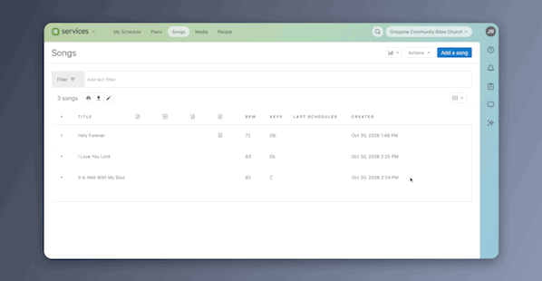

# Horizontal ↔ Vertical Song Tagger for Planning Center

Give every song in your Planning Center Services library a directional rating
from 1 to 5, based on how the song speaks about God or to God:

| Rating | Meaning |
|---|---|
| **1 – Horizontal** | Sung **about** God, for the edification of the church: declaring truth, teaching, testimony |
| **2 – Mostly Horizontal** | Mostly declaration, with a moment of prayer |
| **3 – Blend** | A real mix of the two |
| **4 – Mostly Vertical** | Mostly prayer or praise, with some declaration |
| **5 – Vertical** | Sung **to** God: prayer, praise, and worship addressed to Him |

Each rating is saved as a tag in Planning Center. Once they're there, you can
filter songs by directional rating, report on the balance of your song list,
and plan services that mix the two.

## Download

| Your computer | Download |
|---|---|
| **Mac** (Apple chip or Intel) | [HV-Song-Tagger-Mac.dmg](https://github.com/3CordGuy/planning-center-hv-tagger/releases/latest/download/HV-Song-Tagger-Mac.dmg) |
| **Windows** 10 or 11 | [HV-Song-Tagger-Windows-Setup.exe](https://github.com/3CordGuy/planning-center-hv-tagger/releases/latest/download/HV-Song-Tagger-Windows-Setup.exe) |

There's nothing else to install. Every version is on the
[Releases](https://github.com/3CordGuy/planning-center-hv-tagger/releases) page.

## Opening it the first time

Apple and Microsoft warn you about any app that isn't registered with them,
which costs a yearly fee. This free app isn't registered yet, so you'll see a
warning the first time you open it. After that it opens normally.

**On a Mac:**

1. Open the downloaded file and drag **HV Song Tagger** into your
   **Applications** folder.
2. Double-click **HV Song Tagger** in Applications. A box says Apple *could
   not verify* it. Click **Done**, not Move to Trash.
3. Open the Apple menu, choose **System Settings**, then **Privacy & Security**.
4. Scroll down to **Security**. Next to the message about HV Song Tagger, click
   **Open Anyway**.
5. In the box that appears, click **Open Anyway** again, then enter your Mac
   password or use Touch ID.

If you don't see **Open Anyway**, double-click the app again, then go back to
Privacy & Security. On macOS 14 or older, you can instead Control-click the
app, choose **Open**, and click **Open**.

**On Windows:**

1. Double-click the downloaded **HV-Song-Tagger-Windows-Setup** file.
2. If a blue *Windows protected your PC* box appears, click **More info**, then
   **Run anyway**.
3. Follow the installer, then open **HV Song Tagger** from the Start menu.

**Is it safe?** The warning means the app isn't registered with Apple or
Microsoft. It doesn't mean anything was found wrong with it. Every line of the
code is in this repository for anyone to read. Download it only from this page
or the [project website](https://3cordguy.github.io/planning-center-hv-tagger/),
not from a copy someone sends you.

## How it works

Open the app and follow the four steps across the top:

1. **Connect.** Create a Personal Access Token in Planning Center and paste in
   its Client ID and Secret. The app finds your directional rating tags, or
   shows you how to make them.
2. **Choose songs.** The app loads your songs straight from Planning Center.
   Tag them all, or just the lists you pick.
3. **Tag each song.** Click a rating from 1 to 5 for each song with the
   [rubric](RUBRIC.md) beside you, or let Claude, ChatGPT, or Gemini suggest
   ratings and review only the ones it's unsure about.
4. **Send.** The app sends 3 songs first so you can check them in Planning
   Center, then sends the rest.

**Practice first.** On the first screen, choose **Practice with sample songs**.
It runs the whole process with made-up songs and a pretend Planning Center.
Nothing real changes.

## Setting up the tags in Planning Center

You only do this once. When you connect, the app looks for these tags and
shows you the same steps if they're missing.

1. In Planning Center, open **Services**, then **Songs**.
2. Click **Actions**, then **Edit Tags**, and stay on the **Song** tab.

   

3. Click **Add Tag Group**. Name it **Horizontal Vertical Scale**, leave
   **Allow multiple selections** off, and click **Save**.
4. In the new group, add these five tags. Each one must start with its number:
   - `1 - Horizontal`
   - `2 - Mostly Horizontal`
   - `3 - Blend`
   - `4 - Mostly Vertical`
   - `5 - Vertical`

[Watch a short video of steps 3 and 4](app/media/create-tag-group.mp4).

## Safety

- The app changes only the 1–5 directional rating tag on each song. It keeps
  every other tag (lists, themes, seasons, and so on).
- Running it again is safe. Songs that already have the right rating are
  skipped.
- Your Planning Center key goes only to Planning Center. If you ask the app to
  remember it, it's kept in your Mac's Keychain or Windows Credential Manager.
- Lyrics come straight from your Planning Center account and stay on your
  computer, unless you choose to give them to an AI.

## Choosing a rating

[RUBRIC.md](RUBRIC.md) explains how to choose each song's directional rating,
with edge cases and tips for tagging as a team. There's also a printable
one-page version: [docs/rubric-one-pager.pdf](docs/rubric-one-pager.pdf).

## For developers

- `app/` is the app's interface, and `desktop/` wraps it as the Mac and
  Windows app. See [desktop/README.md](desktop/README.md) to build it.
- Pushing a version tag (for example `v0.1.2`) builds both downloads and
  publishes a release.
- `hv_tagger.py` is the original command-line version. See
  [TECHNICAL.md](TECHNICAL.md).

## Credit and license

This tool was originally developed by the worship team at Wawasee Bible Church.
It's free to use and adapt under the MIT License (see [LICENSE](LICENSE)).

This project isn't affiliated with or endorsed by Planning Center.
